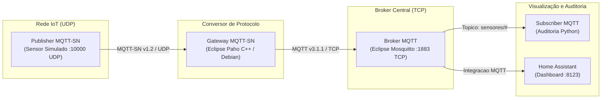

# Integração IoT: Home Assistant com MQTT e MQTT-SN via Gateway

Ambiente experimental conteinerizado para integrar dispositivos sensores IoT de baixo consumo ao **Home Assistant**, utilizando **MQTT**, **MQTT-SN** e um **Gateway de conversão de protocolos (UDP $\rightarrow$ TCP)**.

---

## 1. Visão Geral e Arquitetura

O ecossistema simula uma rede de sensores restritos (IoT) que se comunicam através de datagramas **UDP (MQTT-SN)**. Um Gateway dedicado traduz esses pacotes para o protocolo padrão **TCP (MQTT)** e os encaminha a um Broker central (**Mosquitto**), permitindo a ingestão e visualização de telemetria em tempo real pelo **Home Assistant** e a auditoria por um **Subscriber**.



### Componentes do Sistema

| Serviço / Contêiner | Tecnologia / Base | Papel e Funcionamento |
| :--- | :--- | :--- |
| **`mqttsn-publisher`** | Python 3.11 (`socket`/`struct`) | Simula o sensor IoT. Conecta via UDP (`CONNECT`), registra dinamicamente tópicos (`REGISTER`) e publica temperatura e umidade a cada 5s com `QoS=0` e `MsgId=0x0000`. |
| **`mqttsn-gateway`** | *Eclipse Paho MQTT-SN Gateway* (C++) | Escuta datagramas UDP na porta `10000`, converte a estrutura binária MQTT-SN para MQTT padrão e encaminha via TCP ao Mosquitto. |
| **`mqtt-broker`** | *Eclipse Mosquitto 2.x* | Servidor central de mensageria na porta `1883`, roteando os dados entre Gateway, Home Assistant e Subscriber. |
| **`mqtt-subscriber`** | Python 3.11 (`paho-mqtt`) | Assina o tópico `sensores/#` e exibe no terminal cada mensagem recebida com carimbo de data/hora, QoS e payload para auditoria. |
| **`homeassistant`** | *Home Assistant Core* | Plataforma de automação e dashboard web na porta `8123`, mapeando as leituras para entidades e gráficos históricos. |

---

## 2. Estrutura do Repositório

```text
├── compose.yaml                      # Orquestrador de todos os 5 serviços
├── README.md                         # Guia completo de replicação
├── .gitignore                        # Arquivos ignorados pelo Git
├── mosquitto/
│   └── config/
│       └── mosquitto.conf            # Configuração do broker (porta 1883, allow_anonymous)
├── gateway-mqttsn/
│   ├── Dockerfile                    # Compilação nativa com CMake e OpenSSL
│   └── gateway.conf                  # Roteamento UDP 10000 -> Mosquitto:1883
├── publisher-mqttsn/
│   ├── Dockerfile                    # Contêiner do sensor simulado
│   └── publisher.py                  # Cliente MQTT-SN sobre socket UDP
├── subscriber-mqtt/
│   ├── Dockerfile                    # Contêiner do assinante
│   ├── requirements.txt              # Dependência (paho-mqtt)
│   └── subscriber.py                 # Logger de auditoria MQTT
└── homeassistant/
    ├── configuration.yaml            # Declaração das entidades de sensores MQTT
    ├── automations.yaml
    ├── scripts.yaml
    └── scenes.yaml
```

---

## 3. Pré-requisitos (Na Máquina do Aluno / VM Ubuntu)

Em uma máquina com **Ubuntu 22.04 ou superior** (em VM VMware, VirtualBox ou WSL2), abra o terminal e execute:

```bash
# 1. Atualizar repositórios e instalar Docker + Docker Compose
sudo apt update && sudo apt install -y docker.io docker-compose-v2 git

# 2. Iniciar o serviço do Docker
sudo systemctl enable --now docker

# 3. Adicionar permissão ao seu usuário (evita precisar de sudo toda vez)
sudo usermod -aG docker $USER
newgrp docker
```

---

## 4. Passo a Passo de Execução em Sala de Aula

### Passo 4.1: Clonar o Repositório e Entrar na Pasta

```bash
git clone https://github.com/SEU_USUARIO/SEU_REPOSITORIO.git home-assistant-iot
cd home-assistant-iot
```

### Passo 4.2: Subir o Ambiente Completo

Execute o comando de build e inicialização em segundo plano:

```bash
docker compose up -d --build
```

> **Tempo estimado:** Cerca de 1 a 2 minutos no primeiro uso para compilar o Gateway e baixar as imagens oficiais.

### Passo 4.3: Validar se os 5 Serviços Estão Ativos

```bash
docker compose ps
```

Todos os 5 serviços devem estar com status **`Up`**:
```text
NAME               SERVICE            STATUS
homeassistant      homeassistant      Up
mqtt-broker        mosquitto          Up
mqttsn-gateway     gateway-mqttsn     Up
mqttsn-publisher   publisher-mqttsn   Up
mqtt-subscriber    subscriber-mqtt    Up
```

### Passo 4.4: Inspecionar o Fluxo de Mensagens em Tempo Real

No terminal, acompanhe a chegada das mensagens de temperatura e umidade:

```bash
docker compose logs -f subscriber-mqtt
```

Saída esperada a cada 5 segundos:
```text
============================================================
[2026-10-25 21:15:10] MENSAGEM RECEBIDA VIA BROKER MQTT:
  Topico:  sensores/temperatura
  QoS:     0
  Payload: 23.7
============================================================
```
*(Pressione `Ctrl + C` para sair do modo de acompanhamento).*

---

## 5. Configuração e Visualização no Home Assistant

1. Abra o navegador web e acesse:
   ```text
   http://localhost:8123
   ```
   *(Ou `http://<IP-DA-VM>:8123` caso acesse a partir do computador hospedeiro).*

2. **Cadastro Inicial:** Crie o usuário e senha de administrador para a aula e clique em **Avançar**.

3. **Conectar à Integração MQTT:**
   * No menu lateral esquerdo, vá em **Configurações** $\rightarrow$ **Dispositivos e Serviços**.
   * Clique em **+ Adicionar Integração** e digite `MQTT`.
   * Preencha:
     * **Broker:** `mosquitto`
     * **Porta:** `1883`
     * **Usuário / Senha:** *(deixe em branco)*
   * Clique em **Enviar**.

4. **Visualizar os Gráficos no Histórico:**
   * No menu lateral esquerdo, clique em **Histórico**.
   * Busque por `Temperatura Sala (MQTT-SN)` e `Umidade Sala (MQTT-SN)`.
   * A curva temporal com as variações enviadas pelo sensor aparecerá desenhada instantaneamente.

5. **Exibir no Painel Principal (Dashboard):**
   * Na tela inicial (**Visão Geral**), os sensores aparecerão diretamente no bloco de **Favoritos** exibindo as leituras analógicas em tempo real (`23,7 °C` e `54,2%`).

---

## 6. Pontos Técnicos Críticos e Soluções (Dicas de Troubleshooting)

Para garantir a reprodutibilidade assertiva sem erros, este repositório já traz implementadas as seguintes soluções:

1. **Compilação do Gateway com CMake e OpenSSL:**
   * O código oficial da Eclipse Foundation migrou o build do gateway para CMake (`build.sh udp`), exigindo `libssl-dev` e `ca-certificates`.
   * O Dockerfile utiliza imagem base `debian:bookworm-slim` garantindo compatibilidade com a biblioteca padrão `glibc`.

2. **Conformidade com a Norma MQTT-SN v1.2 (QoS 0):**
   * De acordo com a especificação técnica da OASIS/Eclipse para MQTT-SN, em publicações com `QoS 0`, o campo **`MsgId` DEVE ser estritamente `0x0000`**. Valores incrementais diferentes de zero causam rejeição do pacote pelo gateway com erro `Invalid MsgId`. O script [`publisher.py`](file:///e:/HOME-ASSISTENT/publisher-mqttsn/publisher.py) já segue essa regra.

3. **Comunicação por Nomes de Serviço no Compose:**
   * Todos os contêineres compartilham a rede em modo bridge `iot-net`. O Gateway conecta no broker através do DNS interno `mosquitto:1883`, e o Publisher conecta no Gateway através de `gateway-mqttsn:10000/udp`.

---

## 7. Comandos Úteis de Gerenciamento

```bash
# Ver logs de um serviço específico:
docker compose logs publisher-mqttsn --tail=20
docker compose logs gateway-mqttsn --tail=20
docker compose logs subscriber-mqtt --tail=20

# Parar todos os serviços mantendo configurações salvas:
docker compose stop

# Reiniciar os serviços:
docker compose start

# Destruir contêineres e redes:
docker compose down
```
