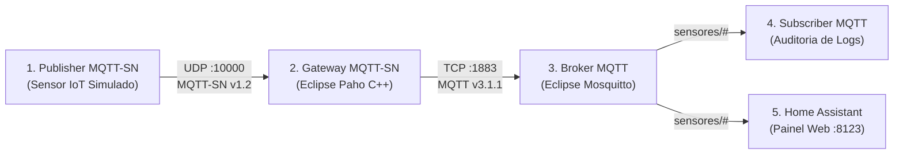
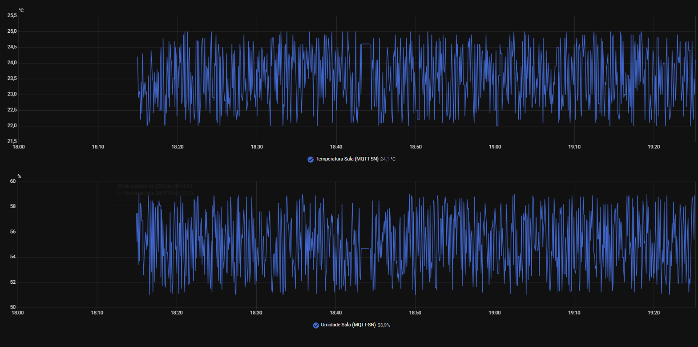
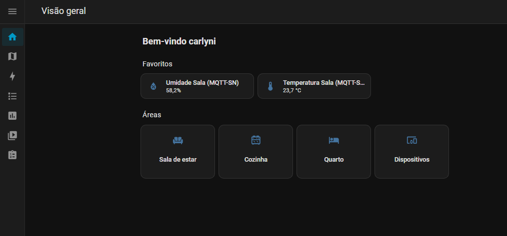

# Integração IoT: Home Assistant com MQTT e MQTT-SN

Este repositório contém o tutorial prático e os arquivos de configuração para implantação de um ambiente experimental baseado em contêineres Docker, integrando dispositivos sensores IoT ao **Home Assistant** através dos protocolos **MQTT** e **MQTT-SN**, com um gateway de conversão intermediário.

---

## 1. Arquitetura e Descrição dos Componentes

O ambiente é composto por **5 componentes conteinerizados** conectados em uma rede interna isolada em modo bridge (`iot-net`):



### Descrição dos Componentes:

1. **Publisher MQTT-SN (`mqttsn-publisher`)**: Simula um nó sensor IoT de baixo consumo de energia. Conecta-se ao Gateway via datagramas **UDP** (porta `10000`), registra os tópicos dinamicamente (`REGISTER`) e publica leituras simuladas de temperatura e umidade em intervalos de 5 segundos.
2. **Gateway MQTT-SN (`mqttsn-gateway`)**: Atua como a ponte de conversão entre a rede de sensores e a infraestrutura corporativa. Implementado a partir do código oficial em C++ do *Eclipse Paho MQTT-SN Gateway*. Escuta na porta UDP `10000`, converte os pacotes binários MQTT-SN para o padrão MQTT tradicional e encaminha via TCP para o broker.
3. **Broker MQTT (`mqtt-broker`)**: Servidor de mensageria central utilizando a imagem oficial do *Eclipse Mosquitto*. Escuta na porta TCP `1883` e gerencia a distribuição das mensagens com suporte a conexões anônimas para ambiente experimental.
4. **Subscriber MQTT (`mqtt-subscriber`)**: Cliente escrito em Python que se conecta ao broker Mosquitto via TCP, inscreve-se no tópico curinga `sensores/#` e imprime no terminal o timestamp, tópico, QoS e payload das mensagens recebidas para auditoria.
5. **Home Assistant (`homeassistant`)**: Plataforma de automação e visualização acessível via navegador na porta `8123`. Conecta-se ao broker Mosquitto através da integração MQTT integrada e mapeia os tópicos em entidades com gráficos de histórico em tempo real.

---

## 2. Orquestração com Docker Compose (`compose.yaml`)

O arquivo [`compose.yaml`](compose.yaml) gerencia todo o ciclo de vida dos serviços, volumes e mapeamento de portas:

```yaml
services:
  mosquitto:
    image: eclipse-mosquitto:2
    container_name: mqtt-broker
    restart: unless-stopped
    ports:
      - "1883:1883"
    volumes:
      - ./mosquitto/config/mosquitto.conf:/mosquitto/config/mosquitto.conf:ro
      - mosquitto_data:/mosquitto/data
      - mosquitto_log:/mosquitto/log
    networks:
      - iot-net

  gateway-mqttsn:
    build:
      context: ./gateway-mqttsn
      dockerfile: Dockerfile
    container_name: mqttsn-gateway
    restart: unless-stopped
    ports:
      - "10000:10000/udp"
    depends_on:
      - mosquitto
    networks:
      - iot-net

  subscriber-mqtt:
    build:
      context: ./subscriber-mqtt
      dockerfile: Dockerfile
    container_name: mqtt-subscriber
    restart: unless-stopped
    environment:
      - BROKER_HOST=mosquitto
      - BROKER_PORT=1883
      - SUBSCRIBE_TOPIC=sensores/#
    depends_on:
      - mosquitto
    networks:
      - iot-net

  publisher-mqttsn:
    build:
      context: ./publisher-mqttsn
      dockerfile: Dockerfile
    container_name: mqttsn-publisher
    restart: unless-stopped
    environment:
      - GATEWAY_HOST=gateway-mqttsn
      - GATEWAY_PORT=10000
      - CLIENT_ID=Sensor-SN-01
      - PUBLISH_INTERVAL=5
    depends_on:
      - gateway-mqttsn
    networks:
      - iot-net

  homeassistant:
    image: ghcr.io/home-assistant/home-assistant:stable
    container_name: homeassistant
    restart: unless-stopped
    ports:
      - "8123:8123"
    volumes:
      - ./homeassistant:/config
    depends_on:
      - mosquitto
    networks:
      - iot-net

networks:
  iot-net:
    driver: bridge

volumes:
  mosquitto_data:
  mosquitto_log:
```

---

## 3. Arquivos de Configuração do Broker e do Gateway

### 3.1. Broker Mosquitto (`mosquitto/config/mosquitto.conf`)
Define a escuta na interface de rede padrão, permissão de conexões anônimas para testes e persistência local:

```conf
listener 1883 0.0.0.0
allow_anonymous true
persistence true
persistence_location /mosquitto/data/
log_dest stdout
```

### 3.2. Gateway MQTT-SN (`gateway-mqttsn/gateway.conf`)
Configura o gateway para escutar na porta UDP `10000` e conectar ao broker Mosquitto via TCP na porta `1883`:

```conf
GatewayID=1
GatewayName=PahoGateway-01
MaxNumberOfClients=30
KeepAlive=60

BrokerName=mosquitto
BrokerPortNo=1883
BrokerSecurePortNo=8883

AggregatingGateway=NO
QoS-1=NO
Forwarder=NO
PredefinedTopic=NO
ClientAuthentication=NO

GatewayPortNo=10000
MulticastPortNo=1883
MulticastIP=225.1.1.1
MulticastTTL=1
```

---

## 4. Dockerfiles e Código-Fonte dos Serviços Customizados

### 4.1. Gateway MQTT-SN (`gateway-mqttsn/Dockerfile`)
Compila nativamente o código C++ do *Eclipse Paho MQTT-SN Gateway* utilizando CMake e OpenSSL sobre imagem `debian:bookworm-slim`:

```dockerfile
FROM debian:bookworm-slim

RUN apt-get update && apt-get install -y --no-install-recommends \
    build-essential \
    cmake \
    git \
    libssl-dev \
    ca-certificates \
    && rm -rf /var/lib/apt/lists/*

WORKDIR /app
RUN git clone https://github.com/eclipse/paho.mqtt-sn.embedded-c.git

WORKDIR /app/paho.mqtt-sn.embedded-c
RUN mkdir -p build && cd build && \
    cmake .. -DSENSORNET=udp && \
    make MQTT-SNGateway && \
    cp /app/paho.mqtt-sn.embedded-c/MQTTSNGateway/bin/MQTT-SNGateway /app/MQTT-SNGateway

WORKDIR /app
COPY gateway.conf /app/gateway.conf

EXPOSE 10000/udp

ENTRYPOINT ["/app/MQTT-SNGateway", "-f", "/app/gateway.conf"]
```

### 4.2. Publisher MQTT-SN (`publisher-mqttsn/publisher.py`)
Script Python que implementa a codificação binária dos pacotes MQTT-SN v1.2 sobre sockets UDP:
* Realiza o handshake `CONNECT` com o Gateway.
* Registra dinamicamente os tópicos `sensores/temperatura` e `sensores/umidade` via `REGISTER`.
* Publica telemetria periódica via `PUBLISH` com `QoS = 0` e `MsgId = 0x0000` (conforme exigido pela norma MQTT-SN).

### 4.3. Subscriber MQTT (`subscriber-mqtt/subscriber.py`)
Script Python que utiliza a biblioteca `paho-mqtt`, inscreve-se no padrão curinga `sensores/#` e imprime as mensagens recebidas formatadas no terminal.

### 4.4. Sensores no Home Assistant (`homeassistant/configuration.yaml`)
Declaração manual das entidades para que o Home Assistant reconheça os dados MQTT recebidos:

```yaml
default_config:

mqtt:
  sensor:
    - name: "Temperatura Sala (MQTT-SN)"
      unique_id: "sensor_temperatura_sala_mqttsn"
      state_topic: "sensores/temperatura"
      unit_of_measurement: "°C"
      device_class: "temperature"
      state_class: "measurement"
    - name: "Umidade Sala (MQTT-SN)"
      unique_id: "sensor_umidade_sala_mqttsn"
      state_topic: "sensores/umidade"
      unit_of_measurement: "%"
      device_class: "humidity"
      state_class: "measurement"
```

---

## 5. Comandos para Iniciar, Parar e Verificar os Serviços

Todos os comandos devem ser executados na raiz do projeto:

* **Iniciar e construir todos os serviços em segundo plano:**
  ```bash
  docker compose up -d --build
  ```

* **Verificar o status dos contêineres:**
  ```bash
  docker compose ps
  ```

* **Acompanhar os logs do Subscriber MQTT (mensagens em tempo real):**
  ```bash
  docker compose logs -f subscriber-mqtt
  ```

* **Acompanhar os logs do Gateway MQTT-SN:**
  ```bash
  docker compose logs -f gateway-mqttsn
  ```

* **Acompanhar os logs do Sensor IoT (Publisher):**
  ```bash
  docker compose logs -f publisher-mqttsn
  ```

* **Pausar os serviços mantendo o banco e as configurações salvas:**
  ```bash
  docker compose stop
  ```

* **Destruir os contêineres e a rede virtual:**
  ```bash
  docker compose down
  ```

---

## 6. Testes Realizados e Evidências de Validação (Guia de Prints)

Para comprovar o funcionamento de ponta a ponta da arquitetura, os testes foram organizados em **4 capturas de tela (prints) obrigatórias**:

---

### 📸 Print 1: Status de Execução dos 5 Contêineres (Terminal)
* **Objetivo:** Provar que toda a infraestrutura está operacional em contêineres Docker.
* **Comando executado no terminal:**
  ```bash
  docker compose ps
  ```
* **Evidência obtida:**
  ```text
  NAME               IMAGE                                          COMMAND                  SERVICE            STATUS
  homeassistant      ghcr.io/home-assistant/home-assistant:stable   "/init"                  homeassistant      Up (healthy)
  mqtt-broker        eclipse-mosquitto:2                            "/docker-entrypoint.…"   mosquitto          Up
  mqtt-subscriber    home-assistant-iot-subscriber-mqtt             "python subscriber.py"   subscriber-mqtt    Up
  mqttsn-gateway     home-assistant-iot-gateway-mqttsn              "/app/MQTT-SNGateway…"   gateway-mqttsn     Up
  mqttsn-publisher   home-assistant-iot-publisher-mqttsn            "python publisher.py"    publisher-mqttsn   Up
  ```

---

### 📸 Print 2: Fluxo de Dados Convertido (Terminal do Subscriber)
* **Objetivo:** Provar que o sensor disparou via UDP (MQTT-SN), o Gateway converteu para TCP (MQTT) e o broker entregou as mensagens intactas.
* **Comando executado no terminal:**
  ```bash
  docker compose logs subscriber-mqtt --tail=10
  ```
* **Evidência obtida (mensagens chegando a cada 5 segundos):**
  ```text
  ============================================================
  [2026-10-25 21:15:05] MENSAGEM RECEBIDA VIA BROKER MQTT:
    Topico:  sensores/temperatura
    QoS:     0
    Payload: 22.9
  ============================================================
  ============================================================
  [2026-10-25 21:15:05] MENSAGEM RECEBIDA VIA BROKER MQTT:
    Topico:  sensores/umidade
    QoS:     0
    Payload: 57.5
  ============================================================
  ```

---

## 7. Instruções para que Outro Aluno Consiga Reproduzir o Ambiente

Qualquer aluno pode reproduzir exatamente este ambiente em uma máquina com Ubuntu (VMware, VirtualBox ou WSL2) seguindo estes 3 passos:

### Passo 1: Instalar o Docker (se ainda não tiver)
```bash
sudo apt update && sudo apt install -y docker.io docker-compose-v2 git
sudo usermod -aG docker $USER
newgrp docker
```

### Passo 2: Clonar o repositório e subir os contêineres
```bash
git clone https://github.com/mariacarlyni-pereira/home-assistant-iot.git
cd home-assistant-iot
docker compose up -d --build
```

### Passo 3: Conectar o Home Assistant ao Broker MQTT
1. Abra o navegador em: `http://localhost:8123` (ou `http://<IP-DA-VM>:8123`).
2. Conclua o cadastro inicial criando seu usuário e senha de administrador.
3. No menu lateral esquerdo, vá em **Configurações** $\rightarrow$ **Dispositivos e Serviços**.
4. Clique no botão **+ Adicionar Integração** e digite `MQTT`.
5. Preencha os parâmetros de conexão:
   * **Broker:** `mosquitto`
   * **Porta:** `1883`
   * *(Deixar nome de usuário e senha em branco)*
   * Clique em **Enviar**.

---

### Passo 4: Como Visualizar o Gráfico no Histórico (Passo a Passo)

Para visualizar as medições em tempo real e a curva de variação do sensor IoT:

1. No menu lateral esquerdo, clique em **Histórico** (ícone de barras gráficas, logo abaixo de "Atividade").
   > **Atenção:** Não utilize a aba "Atividade" para buscar medições analógicas, pois ela monitora apenas eventos discretos de sistema. As curvas de telemetria ficam em **Histórico**.

2. No painel esquerdo da tela de Histórico, clique no botão azul **`+ Adicionar alvo`**.
3. Na janela de pesquisa:
   * Certifique-se de que o filtro **`Entidades`** está marcado em azul (evite o filtro "Dispositivos").
   * Digite `temperatura` e selecione **`Temperatura Sala (MQTT-SN)`**.
   * Clique novamente em **`+ Adicionar alvo`**, digite `umidade` e selecione **`Umidade Sala (MQTT-SN)`**.

4. O Home Assistant traçará instantaneamente o gráfico contínuo com os valores oscilando ao vivo a cada 5 segundos:



5. Na tela inicial (**Visão Geral**), os sensores também já estarão disponíveis no card de **Favoritos** mostrando o valor instantâneo atual:



